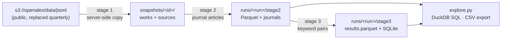
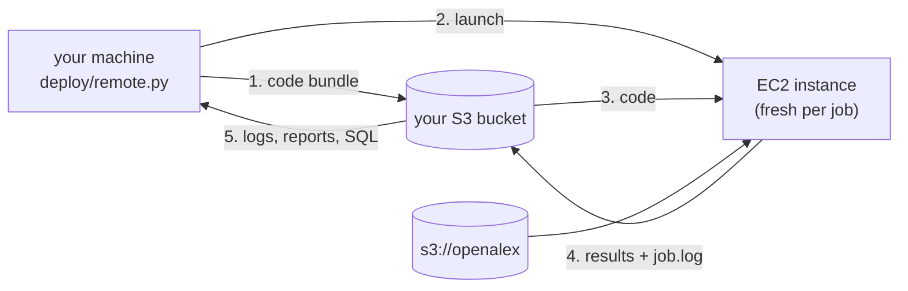

# OA Pipeline

A batch pipeline over the full [OpenAlex](https://openalex.org/) works corpus for a systematic
literature review on sustainable fuels. It runs on a single EC2 instance, keeps all data in S3,
and each stage writes an HTML analytics report plus Parquet you can query with SQL.



| Stage | Script | Does | Report shows |
|---|---|---|---|
| 1 | `pipeline/stage1_mirror.py` | Copies the OpenAlex `works` and `sources` entities into your bucket, pinned by OpenAlex release date | files, size, records by update month, manifest discrepancies, storage cost |
| 2 | `pipeline/stage2_journals.py` | Keeps journal articles (type, journal source, not paratext/retracted/xpac, DOI, language, abstract) | full selection funnel, corpus composition, years, fields, publishers, top journals with impact metrics, data-quality checks |
| 3 | `pipeline/stage3_keywords.py` | Keeps articles whose title/abstract contain a term from **every** keyword group (fuel × impact) | matching funnel, near-misses, subgroup co-occurrence heatmap, per-term hit counts, terms that never occur, top journals, sample matches with highlighted terms |
| — | `pipeline/explore.py` | SQL over any run's outputs; CSV export for Claude Desktop | — |

## Guides

| Guide | For | Where it runs |
|---|---|---|
| [Develop](#develop) | changing code or keywords, running tests | your machine, no AWS needed |
| [Deploy](#deploy) | one-time AWS setup: bucket, permissions, credentials | AWS console + your machine |
| [Run](#run) | launch jobs on EC2, follow logs, get reports | your machine (jobs run on auto-terminating EC2) |

## Develop

Requirements: Python ≥ 3.11 and git. No AWS account is needed, because every stage also runs against a local directory and the tests use a synthetic corpus and mocked S3.

```bash
git clone https://github.com/lielmazar/oa_pipeline.git && cd oa_pipeline
```

```bash
python3 -m venv .venv && .venv/bin/pip install -e ".[dev]"
```

```bash
.venv/bin/pytest
```

The test suite runs all three stages end to end on a local folder, the S3 code paths against moto, multi-process workers, resume and restart, and partial runs. It takes a few seconds.

To try the real pipeline on real OpenAlex data without AWS credentials, use a local `storage_root`. The public bucket is read anonymously, and `--smoke` mirrors only 2 small partitions:

```bash
.venv/bin/python -m pipeline.run_all --storage-root ./data --run-id local --smoke --workers 2
```

Reports end up in `./data/runs/local/stage2/report.html` and `stage3/report.html`.

Where to change things:

| Change | File |
|---|---|
| Keywords, subgroups, column docs | `pipeline/research_schema.json` (the `keywords` section) |
| Stage 2 selection rules | `config.yaml` → `stage2:` |
| How a record is screened / flattened | `pipeline/lib/records.py` (`screen`, `work_row`, `WORK_FIELDS`) |
| Term normalisation and matching | `pipeline/lib/keywords.py` |
| Report content | `build_report` in each `stage*.py`; HTML components in `pipeline/lib/report.py` |
| S3/local file access | `pipeline/lib/storage.py` |

After changing keywords, re-run stage 3 with `--restart` (or under a new `--run-id`). After changing stage 2 rules, use a new `--run-id`.

## Deploy

One-time setup, done in the AWS console and on your machine. **You never log into an instance.** Each job runs on a fresh EC2 instance that your machine launches: it downloads your code from your own bucket, runs the pipeline, streams its log to S3, and terminates itself.



All AWS settings live in [`deploy/aws.env`](deploy/aws.env). Every value that must match something you create in the console is tagged `[console]` there, with a note on where to find it.

| `deploy/aws.env` key | Must match (console) | Default |
|---|---|---|
| `AWS_PROFILE` | IAM user access key, saved with `aws configure` | default profile |
| `AWS_REGION` | the bucket's region (S3 → bucket → Properties) | `us-east-1` |
| `OA_BUCKET` | S3 → Buckets, and the bucket named in `deploy/iam_policy.json` | `liel-oa-pipeline` |
| `EC2_INSTANCE_PROFILE` | IAM → Roles → the EC2 role | `oa-pipeline-ec2` |
| `EC2_SUBNET_ID` | VPC → Subnets (needs internet access) | default VPC |
| `EC2_SECURITY_GROUP_ID` | EC2 → Security Groups (outbound only) | VPC default group |
| `EC2_KEY_NAME` | EC2 → Key pairs (optional, only for SSH debugging) | none |
| `OA_STORAGE_ROOT`, `OA_RUN_ID`, `EC2_INSTANCE_TYPE`, `EC2_SPOT`, `EC2_ROOT_VOLUME_GB`, `EC2_AUTO_TERMINATE`, `EC2_MAX_HOURS`, `EC2_AMI_PARAMETER`, `EC2_NAME_TAG` | — (plain defaults) | see file |

Put personal overrides in `deploy/aws.local.env` (gitignored). Real environment variables override both files.

### 1. Create the S3 bucket

In the S3 console, choose **Create bucket**:

| Field | Value |
|---|---|
| Region | US East (N. Virginia) us-east-1 |
| Bucket type | General purpose |
| Bucket namespace | Global namespace |
| Bucket name | e.g. `liel-oa-pipeline` (lowercase, digits, hyphens; no dots) → `OA_BUCKET` |
| Object Ownership | ACLs disabled |
| Block all public access | On |
| Bucket Versioning | Disable (otherwise `--restart` and rewritten reports leave billed hidden copies) |
| Default encryption | SSE-S3 |
| Object Lock | Disable |

Also set the bucket in [`config.yaml`](config.yaml) (`storage_root: s3://<bucket>/openalex`). Local commands such as `explore.py` read it from there.

### 2. Create two IAM policies

Go to **IAM → Policies → Create policy → JSON**, paste the file, and give it the name shown:

| Policy name | File | Grants |
|---|---|---|
| `oa-pipeline-s3` | [`deploy/iam_policy.json`](deploy/iam_policy.json) (edit the bucket name first) | read the public OpenAlex bucket; read/write/delete in your bucket |
| `oa-pipeline-operator` | [`deploy/iam_policy_operator.json`](deploy/iam_policy_operator.json) | launch, watch and terminate instances with the `oa-pipeline-ec2` role; look up the Ubuntu image |

### 3. Create the role the instances use

Go to **IAM → Roles → Create role**, choose **AWS service → EC2**, attach `oa-pipeline-s3`, and name the role `oa-pipeline-ec2` (this becomes `EC2_INSTANCE_PROFILE`). `AmazonSSMManagedInstanceCore` is optional; it's only needed to open a browser shell on a kept instance.

### 4. Credentials for your machine

1. Go to **IAM → Users → Create user**, name it `oa-pipeline-dev`, choose **Attach policies directly**, and select **both** `oa-pipeline-s3` and `oa-pipeline-operator`.
2. Open the user → **Security credentials → Create access key**, choose **Command Line Interface**, and copy the key and secret.
3. Store them locally with region `us-east-1`. If you use a named profile (`--profile NAME`), set `AWS_PROFILE=NAME` in `deploy/aws.env`.

```bash
.venv/bin/pip install awscli && .venv/bin/aws configure
```

### 5. Check everything

```bash
.venv/bin/python deploy/remote.py check
```

The check confirms your credentials, that the bucket exists, that the instance profile exists, the Ubuntu image lookup, and a **dry-run launch**, which proves you're allowed to start an instance with that role without starting one. Each failure prints which `aws.env` key or console item to fix. Also run the bucket-side preflight:

```bash
.venv/bin/python -m pipeline.check_aws
```

That's all the setup. You don't launch an instance by hand.

## Run

From the repo root on your machine, with the venv active (`source .venv/bin/activate`). `launch` uploads your working copy, including uncommitted edits, so what runs is exactly what you have locally.

### 1. Smoke test (about 10 minutes, including about 4 minutes of instance start-up)

```bash
python deploy/remote.py launch --run-id smoke -- python -m pipeline.run_all --smoke
```

```bash
python deploy/remote.py logs --follow
```

`logs --follow` streams the job's output until it finishes, then the instance terminates itself. While the instance is still installing, `python deploy/remote.py status` shows its start-up console instead. Expect the reports to say **incomplete** (the snapshot is partial) and stage 3 may find no matches, because the smoke test only processes 2 tiny 2016 partitions.

### 2. Full run

On 32 cores, optionally with `--spot`:

```bash
python deploy/remote.py launch --instance-type c6id.8xlarge -- python -m pipeline.run_all
```

You can also launch the stages one at a time and read each report before continuing:

```bash
python deploy/remote.py launch -- python -m pipeline.stage1_mirror
```

```bash
python deploy/remote.py launch --instance-type c6id.8xlarge -- python -m pipeline.stage2_journals
```

```bash
python deploy/remote.py launch -- python -m pipeline.stage3_keywords
```

`python -m pipeline.stage1_mirror --dry-run` also runs fine locally. It lists the release and writes the stage 1 report (size, records, monthly storage cost) without copying anything.

**What to expect** (OpenAlex release 2026-09-23, measured on real partitions):

| | Size | Notes |
|---|---|---|
| Works snapshot | 2,040 files, 659 GB gzipped, 476M records | `sources` adds 0.3 GB |
| Mirror storage | ≈ $15/month (S3 Standard) | server-side copy, no transfer charge within us-east-1 |
| Stage 2 throughput | ≈ 26,000 records/s per core | on 32 cores the CPU work is roughly 10–15 minutes; downloading 659 GB to the instance usually dominates |
| Stage 3 throughput | ≈ 5,700 records/s per core | only runs on stage 2's output |

### 3. Watch, resume, re-run

| Command | What it does |
|---|---|
| `python deploy/remote.py list` | recent jobs: state, instance, command |
| `python deploy/remote.py status [JOB]` | job + instance state and the last log lines (latest job if omitted; a prefix of the job id is enough) |
| `python deploy/remote.py logs [JOB] [-f]` | the full log, optionally followed live |
| `python deploy/remote.py terminate [JOB \| i-…]` | stop paying for a job's instance now |

- **Interrupted?** (spot reclaim, `EC2_MAX_HOURS` safety stop, failed partitions) Launch the same command again. Finished partitions are skipped, and failed ones are retried.
- **Changed keywords?** Launch `python -m pipeline.stage3_keywords --restart`, or use a new `--run-id` to keep the old results.
- **Changed stage 2 rules?** Use a new `--run-id`.
- **Only want to regenerate a report?** Add `--report-only`.
- **New OpenAlex release?** (quarterly) Stage 1 mirrors it under a new snapshot ID. Start a new run ID for it.
- **Debugging a failed start-up?** Add `--keep` to `launch` so the instance stays up after the job. Terminate it yourself afterwards.

Job files (`job.json`, `status.json`, `job.log`, and the code bundle) are kept in `<storage_root>/deploy/jobs/<job_id>/`.

### 4. Get the reports

Download a report from S3 to `./reports/<run_id>/`:

```bash
python -m pipeline.explore --run-id smoke report 2
```

```bash
python -m pipeline.explore report 3
```

Each stage also writes `report.json` with the same numbers. See [Exploring the data](#exploring-the-data) for SQL access.

### Costs and safety nets

- An instance only exists while a job runs (`EC2_AUTO_TERMINATE=true`).
- `EC2_MAX_HOURS` (12 by default) shuts it down regardless of what the job is doing.
- The mirror costs about $15/month. Check **EC2 → Instances** (filter by tag `oa-pipeline-job`) if in doubt.

### Alternative: work on an instance yourself

If you'd rather run commands interactively, launch an Ubuntu 24.04 instance with the `oa-pipeline-ec2` role, then:

1. **Connect.** Either use **EC2 → Connect → Session Manager** (needs `AmazonSSMManagedInstanceCore` on the role; then run `sudo su - ubuntu`), or SSH as `ubuntu@<public-ip>` with your key pair, after copying the `.pem` into `~/.ssh` and `chmod 400` on it.
2. **Get the code.** The repository is private, so add a read-only **deploy key**: run `ssh-keygen -t ed25519 -f ~/.ssh/github_deploy -N ""` on the instance, paste `~/.ssh/github_deploy.pub` under [repo → Settings → Deploy keys](https://github.com/lielmazar/oa_pipeline/settings/keys) with write access off, and add `Host github.com` / `IdentityFile ~/.ssh/github_deploy` / `IdentitiesOnly yes` to `~/.ssh/config`. Then clone `git@github.com:lielmazar/oa_pipeline.git`.
3. **Set up and run.** Run `bash deploy/ec2_bootstrap.sh`, set `tmp_dir: /mnt/scratch` in `config.yaml`, run `python -m pipeline.check_aws`, and start jobs inside `tmux new -A -s oa`.

## Exploring the data

`explore.py` opens DuckDB with these views: `stage2` (journal articles), `journals` (journal metrics from the `sources` entity), and `stage3` / `filtered_records` (matches). It reads straight from S3 with the instance credentials, or from a local `storage_root`.

```bash
python -m pipeline.explore tables                    # views, row counts, documented columns
python -m pipeline.explore sql "SELECT journal_name, count(*) n FROM stage3 GROUP BY 1 ORDER BY n DESC LIMIT 20"
python -m pipeline.explore sql "SELECT * FROM stage3 WHERE fuel_in_title AND impact_in_title" --out both_in_title.csv
python -m pipeline.explore sql "SELECT s.title, j.two_yr_mean_citedness FROM stage3 s JOIN journals j USING (journal_id) ORDER BY 2 DESC LIMIT 20"
python -m pipeline.explore sample -n 5               # random matches with their terms
python -m pipeline.explore shell                     # interactive SQL
python -m pipeline.explore export --out exports/     # ≤25 MB CSV parts + schema, zipped, for Claude Desktop
```

Useful columns: list columns such as `matched_fuel_terms` and `countries` can be queried with `list_contains(...)` or `unnest(...)`. `raw_json` holds the complete original OpenAlex record, e.g. `json_extract(raw_json, '$.authorships[0].institutions')`. The [stage 3 report](#4-get-the-reports) and `research_schema.json` document every column.

You can also use any Parquet tool on the files directly (pandas, polars, Spark, Athena): `runs/<run_id>/stage3/results.parquet` holds all matches in one file.

## Configuration

Everything is in [`config.yaml`](config.yaml). The most-used values can be overridden per command with `--storage-root`, `--snapshot-id`, `--run-id`, `--workers` and `--tmp-dir`.

- **Stage 2 rules** (`stage2:`): `work_types`, `require_journal_source`, `allow_location_fallback` (accept a journal found in a non-primary location, e.g. for PubMed-hosted copies), `exclude_paratext` / `exclude_retracted` / `exclude_xpac`, `require_doi`, `languages`, `allow_unknown_language`, `require_abstract`, `store_raw_json`. Note that many older Crossref records have `language: null`. They are dropped unless `allow_unknown_language: true`, and the funnel shows how many that affects.
- **Keywords** (`stage3.keywords_file`): the `keywords` section of [`pipeline/research_schema.json`](pipeline/research_schema.json). Each group has a `key` (used in column names: `matched_<key>_terms`, `<key>_in_title`), a name, and subgroups of terms. Matching is case-insensitive on normalised, lightly-stemmed tokens: `emissions` ≈ `emission`, `bio-oil` ≈ `bio oil` ≈ `biooil`, `PM2.5` ≈ `pm25`. Title and abstract are matched separately, so a phrase can't span the two.

### Runs, resuming and reproducibility

- **Snapshots.** Stage 1 names each snapshot after the OpenAlex release date in `s3://openalex/data/jsonl/manifest.json` and records every file in `snapshot_manifest.json`. OpenAlex writes that manifest last, so if it's missing (a release in progress) the snapshot is marked partial. Side files such as `deleted_ids.csv.gz` aren't mirrored. Later stages use the newest snapshot unless you pass `--snapshot-id`.
- **Format.** OpenAlex publishes the same data as JSON Lines (`data/jsonl`) and as Parquet (`data/parquet`). The pipeline uses JSON Lines so that `raw_json` keeps each record exactly as published.
- **Runs.** A **run** (`run_id`) is pinned to one snapshot and one set of stage 2 rules (`runs/<run_id>/run.json`). Stage 3 also pins its keyword list (`stage3/keywords.json`). If you change either, the stage refuses to mix results: use a new `--run-id`, or `--restart` to discard that stage's outputs.
- **Resuming.** Every partition writes its stats file last, which marks it as done. Re-running a stage only processes missing or failed partitions, so after a spot interruption you just run the same command again.
- **Partial results.** If you used `--max-files`, `--max-partitions`, or some partitions failed, the reports say "incomplete" and `report.json` has `"complete": false`.
- **Rebuilding reports.** `--report-only` rebuilds a report from existing outputs.

## Storage layout

```
<storage_root>/
  snapshots/<snapshot_id>/
    data/works/updated_date=…/part_NNNN.gz     mirrored OpenAlex works
    data/sources/…                             mirrored journal metadata
    snapshot_manifest.json, stage1_report.html/json
  runs/<run_id>/
    run.json
    stage2/parquet/*.parquet, stage2/stats/*.json, stage2/journals.parquet, stage2/report.html/json
    stage3/parquet/*.parquet, stage3/stats/*.json, stage3/keywords.json,
    stage3/results.parquet, stage3/filtered_records.sqlite, stage3/report.html/json
  deploy/jobs/<job_id>/
    code.tar.gz, job.json, status.json, job.log     remote jobs launched by deploy/remote.py
```

## Repository layout

```
config.yaml                 run configuration
pipeline/
  stage1_mirror.py          stage 1 — mirror snapshot to S3
  stage2_journals.py        stage 2 — journal-article filter
  stage3_keywords.py        stage 3 — keyword-pair filter
  explore.py                SQL exploration, report download, CSV export
  run_all.py                stages 1→3 in sequence
  check_aws.py              preflight: credentials, bucket access, DuckDB-on-S3
  research_schema.json      keywords, column docs, LLM taxonomy
  lib/                      config, storage (S3/local), records, keywords, parallel runner, reports
llm/                        parked LLM classification + QA code, to become stages 4–5
deploy/                     remote.py (launch/watch EC2 jobs), job_agent.py, aws.env, IAM policies, bootstrap
tests/                      synthetic-corpus tests (local + mocked S3)
```
