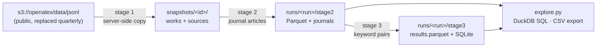

# OA Pipeline

A batch pipeline over the full [OpenAlex](https://openalex.org/) works corpus for a systematic
literature review on sustainable fuels. It runs on a single EC2 instance, keeps all data in S3,
and each stage writes an HTML analytics report plus Parquet you can query with SQL.



| Stage | Script | Does | Report shows |
|---|---|---|---|
| 1 | `pipeline/stage1_mirror.py` | Copies the OpenAlex `works` and `sources` entities into your bucket, pinned by OpenAlex release date | files, size, records by update month, manifest discrepancies, storage cost |
| 2 | `pipeline/stage2_journals.py` | Keeps journal articles (type, journal source, not paratext/retracted/xpac, DOI, language, abstract) | full selection funnel, corpus composition, years, fields, publishers, top journals with impact metrics, data-quality checks |
| 3 | `pipeline/stage3_keywords.py` | Keeps articles whose title/abstract contain a term from **every** keyword group (fuel × impact) | matching funnel, near-misses, subgroup co-occurrence heatmap, per-term hit counts, terms that never occur, top journals, sample matches with highlighted terms |
| — | `pipeline/explore.py` | SQL over any run's outputs; CSV export for Claude Desktop | — |

## Guides

| Guide | For | Where it runs |
|---|---|---|
| [Develop](#develop) | changing code or keywords, running tests | your machine, no AWS needed |
| [Deploy](#deploy) | one-time AWS setup: bucket, permissions, EC2 instance | AWS console + instance |
| [Run](#run) | smoke test, full run, reports, resuming | laptop (small tests) or EC2 (full corpus) |

## Develop

Requirements: Python ≥ 3.11 and git. No AWS account is needed, because every stage also runs against a local directory and the tests use a synthetic corpus and mocked S3.

```bash
git clone https://github.com/lielmazar/oa_pipeline.git && cd oa_pipeline
```

```bash
python3 -m venv .venv && .venv/bin/pip install -e ".[dev]"
```

```bash
.venv/bin/pytest
```

The test suite runs all three stages end to end on a local folder, the S3 code paths against moto, multi-process workers, resume and restart, and partial runs. It takes a few seconds.

To try the real pipeline on real OpenAlex data without AWS credentials, use a local `storage_root`. The public bucket is read anonymously, and `--smoke` mirrors only 2 small partitions:

```bash
.venv/bin/python -m pipeline.run_all --storage-root ./data --run-id local --smoke --workers 2
```

Reports end up in `./data/runs/local/stage2/report.html` and `stage3/report.html`.

Where to change things:

| Change | File |
|---|---|
| Keywords, subgroups, column docs | `pipeline/research_schema.json` (the `keywords` section) |
| Stage 2 selection rules | `config.yaml` → `stage2:` |
| How a record is screened / flattened | `pipeline/lib/records.py` (`screen`, `work_row`, `WORK_FIELDS`) |
| Term normalisation and matching | `pipeline/lib/keywords.py` |
| Report content | `build_report` in each `stage*.py`; HTML components in `pipeline/lib/report.py` |
| S3/local file access | `pipeline/lib/storage.py` |

After changing keywords, re-run stage 3 with `--restart` (or under a new `--run-id`). After changing stage 2 rules, use a new `--run-id`.

## Deploy

One-time setup. Everything is in **us-east-1**, the same region as the OpenAlex bucket, so mirroring and reading have no data-transfer charge.

### 1. Create the S3 bucket

In the S3 console, choose **Create bucket**:

| Field | Value |
|---|---|
| Region | US East (N. Virginia) us-east-1 |
| Bucket type | General purpose |
| Bucket namespace | Global namespace |
| Bucket name | e.g. `liel-oa-pipeline` (lowercase, digits, hyphens; no dots) |
| Object Ownership | ACLs disabled |
| Block all public access | On |
| Bucket Versioning | Disable (otherwise `--restart` and rewritten reports leave billed hidden copies) |
| Default encryption | SSE-S3 |
| Object Lock | Disable |

Then set the bucket in [`config.yaml`](config.yaml): `storage_root: s3://<bucket>/openalex`.

### 2. Create the permissions policy

1. In [`deploy/iam_policy.json`](deploy/iam_policy.json), make sure the `PipelineBucket` statement names your bucket.
2. **IAM → Policies → Create policy → JSON**: paste the file, and name it `oa-pipeline-s3`.

The policy grants read access to the public OpenAlex bucket and read/write/delete on your bucket only.

### 3. Credentials for your laptop (optional, for small tests and downloading reports)

1. **IAM → Users → Create user** `oa-pipeline-dev`, choose **Attach policies directly**, and select `oa-pipeline-s3`.
2. Open the user → **Security credentials → Create access key**, choose **Command Line Interface**, and copy the key and secret.
3. Install the AWS CLI into the venv and configure it (region `us-east-1`):

```bash
.venv/bin/pip install awscli && .venv/bin/aws configure
```

### 4. EC2 role and instance

1. **IAM → Roles → Create role**: choose **AWS service → EC2** and attach `oa-pipeline-s3`. Optionally also attach `AmazonSSMManagedInstanceCore`, which lets you connect from the browser without SSH keys. Name the role `oa-pipeline-ec2`.
2. **EC2 → Launch instance** (us-east-1):
   - AMI: Ubuntu Server 24.04 LTS (x86).
   - Type: `c6id.2xlarge` (8 vCPU) for tests, `c6id.8xlarge` (32 vCPU, 1.9 TB NVMe) for the full corpus. Stage 2 scales with cores. The `d` types have local NVMe for scratch.
   - Key pair for SSH, and a security group allowing SSH from **My IP** only.
   - Root volume: 30 GB.
   - **Advanced details → IAM instance profile**: `oa-pipeline-ec2`.
   - Spot pricing is fine: every stage resumes after an interruption.
3. Connect (SSH or Session Manager), then:

```bash
git clone https://github.com/lielmazar/oa_pipeline.git && cd oa_pipeline
```

```bash
bash deploy/ec2_bootstrap.sh
```

The bootstrap script installs Python dependencies and tmux, mounts the NVMe disk at `/mnt/scratch`, and pre-installs DuckDB's S3 extensions.

4. In `config.yaml` on the instance, set `tmp_dir: /mnt/scratch`. `storage_root` should already point to your bucket.

### 5. Preflight check

Run this on the instance, and on your laptop if you configured credentials:

```bash
.venv/bin/python -m pipeline.check_aws
```

It checks credentials, reading the OpenAlex release manifest, write and delete in your bucket, and DuckDB reading Parquet from your bucket. All four lines should say `OK`:

- **Credentials fail**: the instance profile isn't attached (EC2), or `aws configure` wasn't run (laptop).
- **AccessDenied on write**: the bucket name in the policy doesn't match `storage_root`.

### Updating the code on the instance

```bash
git pull && .venv/bin/pip install -e ".[dev]"
```

## Run

All commands are run from the repo root with the venv active (`source .venv/bin/activate`). On EC2, run long jobs inside tmux so they survive disconnects. Use `tmux new -s oa` to start, Ctrl-B D to detach, and `tmux attach -t oa` to return.

### 1. Smoke test (minutes)

This mirrors 2 works partitions and runs every stage on them. It works from your laptop too, because the data involved is tiny:

```bash
python -m pipeline.run_all --smoke --run-id smoke
```

The reports will say **incomplete**, because the snapshot is partial. The oldest partitions are small 2016 files, so stage 3 may find no matches. What the smoke test proves is that every step, permission and report works.

### 2. Full run

```bash
python -m pipeline.run_all
```

Or stage by stage, which is useful to inspect each report before continuing:

```bash
python -m pipeline.stage1_mirror --dry-run
```

```bash
python -m pipeline.stage1_mirror
```

```bash
python -m pipeline.stage2_journals
```

```bash
python -m pipeline.stage3_keywords
```

`--dry-run` lists the release and writes the stage 1 report (size, records, monthly storage cost) without copying anything.

**What to expect** (OpenAlex release 2026-09-23, measured on real partitions):

| | Size | Notes |
|---|---|---|
| Works snapshot | 2,040 files, 659 GB gzipped, 476M records | `sources` adds 0.3 GB |
| Mirror storage | ≈ $15/month (S3 Standard) | server-side copy, no transfer charge within us-east-1 |
| Stage 2 throughput | ≈ 26,000 records/s per core | on 32 cores the CPU work is roughly 10–15 minutes; downloading 659 GB to the instance usually dominates |
| Stage 3 throughput | ≈ 5,700 records/s per core | only runs on stage 2's output |

Progress lines (partitions done, records/s, ETA) go to the terminal and to `logs/`.

### 3. Monitor, resume, re-run

- **Interrupted?** (disconnect, spot reclaim, Ctrl-C, failed partitions) Run the same command again. Finished partitions are skipped, and failed ones are retried.
- **Changed keywords?** Run `python -m pipeline.stage3_keywords --restart`, or use a new `--run-id` to keep the old results.
- **Changed stage 2 rules?** Use a new `--run-id`, for example `--run-id fuels-v2-anylang`.
- **Only want to regenerate a report?** Add `--report-only`.
- **New OpenAlex release?** (quarterly) Running stage 1 again mirrors it under a new snapshot ID. Start a new run ID for it.

### 4. Get the reports

Download a report from S3 to `./reports/<run_id>/`:

```bash
python -m pipeline.explore report 2
```

```bash
python -m pipeline.explore report 3
```

Each stage also writes `report.json` with the same numbers. See [Exploring the data](#exploring-the-data) for SQL access.

### 5. Stop the instance

The results live in S3. Stop or terminate the EC2 instance when the run is done: an idle instance is the main cost, and the mirror costs about $15/month.

## Exploring the data

`explore.py` opens DuckDB with these views: `stage2` (journal articles), `journals` (journal metrics from the `sources` entity), and `stage3` / `filtered_records` (matches). It reads straight from S3 with the instance credentials, or from a local `storage_root`.

```bash
python -m pipeline.explore tables                    # views, row counts, documented columns
python -m pipeline.explore sql "SELECT journal_name, count(*) n FROM stage3 GROUP BY 1 ORDER BY n DESC LIMIT 20"
python -m pipeline.explore sql "SELECT * FROM stage3 WHERE fuel_in_title AND impact_in_title" --out both_in_title.csv
python -m pipeline.explore sql "SELECT s.title, j.two_yr_mean_citedness FROM stage3 s JOIN journals j USING (journal_id) ORDER BY 2 DESC LIMIT 20"
python -m pipeline.explore sample -n 5               # random matches with their terms
python -m pipeline.explore shell                     # interactive SQL
python -m pipeline.explore export --out exports/     # ≤25 MB CSV parts + schema, zipped, for Claude Desktop
```

Useful columns: list columns such as `matched_fuel_terms` and `countries` can be queried with `list_contains(...)` or `unnest(...)`. `raw_json` holds the complete original OpenAlex record, e.g. `json_extract(raw_json, '$.authorships[0].institutions')`. The [stage 3 report](#4-get-the-reports) and `research_schema.json` document every column.

You can also use any Parquet tool on the files directly (pandas, polars, Spark, Athena): `runs/<run_id>/stage3/results.parquet` holds all matches in one file.

## Configuration

Everything is in [`config.yaml`](config.yaml). The most-used values can be overridden per command with `--storage-root`, `--snapshot-id`, `--run-id`, `--workers` and `--tmp-dir`.

- **Stage 2 rules** (`stage2:`): `work_types`, `require_journal_source`, `allow_location_fallback` (accept a journal found in a non-primary location, e.g. for PubMed-hosted copies), `exclude_paratext` / `exclude_retracted` / `exclude_xpac`, `require_doi`, `languages`, `allow_unknown_language`, `require_abstract`, `store_raw_json`. Note that many older Crossref records have `language: null`. They are dropped unless `allow_unknown_language: true`, and the funnel shows how many that affects.
- **Keywords** (`stage3.keywords_file`): the `keywords` section of [`pipeline/research_schema.json`](pipeline/research_schema.json). Each group has a `key` (used in column names: `matched_<key>_terms`, `<key>_in_title`), a name, and subgroups of terms. Matching is case-insensitive on normalised, lightly-stemmed tokens: `emissions` ≈ `emission`, `bio-oil` ≈ `bio oil` ≈ `biooil`, `PM2.5` ≈ `pm25`. Title and abstract are matched separately, so a phrase can't span the two.

### Runs, resuming and reproducibility

- **Snapshots.** Stage 1 names each snapshot after the OpenAlex release date in `s3://openalex/data/jsonl/manifest.json` and records every file in `snapshot_manifest.json`. OpenAlex writes that manifest last, so if it's missing (a release in progress) the snapshot is marked partial. Side files such as `deleted_ids.csv.gz` aren't mirrored. Later stages use the newest snapshot unless you pass `--snapshot-id`.
- **Format.** OpenAlex publishes the same data as JSON Lines (`data/jsonl`) and as Parquet (`data/parquet`). The pipeline uses JSON Lines so that `raw_json` keeps each record exactly as published.
- **Runs.** A **run** (`run_id`) is pinned to one snapshot and one set of stage 2 rules (`runs/<run_id>/run.json`). Stage 3 also pins its keyword list (`stage3/keywords.json`). If you change either, the stage refuses to mix results: use a new `--run-id`, or `--restart` to discard that stage's outputs.
- **Resuming.** Every partition writes its stats file last, which marks it as done. Re-running a stage only processes missing or failed partitions, so after a spot interruption you just run the same command again.
- **Partial results.** If you used `--max-files`, `--max-partitions`, or some partitions failed, the reports say "incomplete" and `report.json` has `"complete": false`.
- **Rebuilding reports.** `--report-only` rebuilds a report from existing outputs.

## Storage layout

```
<storage_root>/
  snapshots/<snapshot_id>/
    data/works/updated_date=…/part_NNNN.gz     mirrored OpenAlex works
    data/sources/…                             mirrored journal metadata
    snapshot_manifest.json, stage1_report.html/json
  runs/<run_id>/
    run.json
    stage2/parquet/*.parquet, stage2/stats/*.json, stage2/journals.parquet, stage2/report.html/json
    stage3/parquet/*.parquet, stage3/stats/*.json, stage3/keywords.json,
    stage3/results.parquet, stage3/filtered_records.sqlite, stage3/report.html/json
```

## Repository layout

```
config.yaml                 run configuration
pipeline/
  stage1_mirror.py          stage 1 — mirror snapshot to S3
  stage2_journals.py        stage 2 — journal-article filter
  stage3_keywords.py        stage 3 — keyword-pair filter
  explore.py                SQL exploration, report download, CSV export
  run_all.py                stages 1→3 in sequence
  check_aws.py              preflight: credentials, bucket access, DuckDB-on-S3
  research_schema.json      keywords, column docs, LLM taxonomy
  lib/                      config, storage (S3/local), records, keywords, parallel runner, reports
llm/                        parked LLM classification + QA code, to become stages 4–5
deploy/                     EC2 bootstrap script and IAM policy
tests/                      synthetic-corpus tests (local + mocked S3)
```
