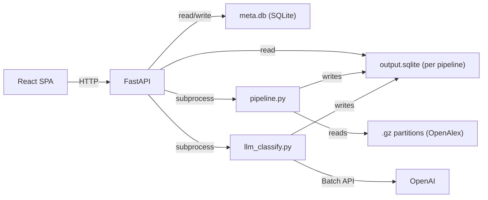

# OA Pipeline

A browser-based systematic literature review tool built on the [OpenAlex](https://openalex.org/) academic corpus. Designed for a sustainable-fuels research project, the pipeline filters millions of works by keyword co-occurrence, classifies them with the OpenAI Batch API, supports multi-researcher inter-rater reliability (IRR), and exports data for final analysis and article generation in Claude Desktop.

## Workflow

The application is organized into four tabs, each self-contained — configure, execute, view results:

| Tab | What happens |
|-----|-------------|
| **Search** | Define keyword groups and subgroups, run the filter across OpenAlex `.gz` partitions, view preset charts (publications by year, top countries, journals, OA status, work types, institutions), select subsets |
| **LLM** | Estimate cost, submit an OpenAI Batch API classification job, poll status, collect results into the database, view LLM charts (fuel classification, ML role, algorithm, heatmaps, co-occurrence matrices) |
| **QA** | Inter-rater reliability — multiple researchers independently rate LLM labels, compute Krippendorff's alpha, review disagreements |
| **Export** | Download the SQLite database, download auto-chunked CSVs (each under 30 MB) packaged with `research_schema.json` and `schema.csv` for Claude Desktop, or download the schema file alone |

## Architecture



- **Browser** — React 18 single-page application built with Vite and Tailwind CSS. Communicates exclusively over `/api/*` JSON endpoints. In production, FastAPI serves the built SPA from `api/static/`.
- **FastAPI backend** — handles auth, pipeline CRUD, job orchestration, chart config, QA, and export. Uses two SQLite databases: a shared `meta.db` for users/pipelines/subsets/ratings, and a per-pipeline `output.sqlite` for filtered research records.
- **Pipeline scripts** — heavy processing runs as Python subprocesses. `pipeline.py` filters OpenAlex `.gz` partitions using multiprocessing. `llm_classify.py` drives the OpenAI Batch API lifecycle (estimate, prepare, submit, poll, save).

## Directory Structure

```
api/                          FastAPI backend
  main.py                     App factory, router registration, SPA serving
  config.py                   Settings from environment / .env
  deps.py                     FastAPI dependency injection (auth, DB)
  routers/
    auth.py                   Login / logout / me (session cookie)
    pipelines.py              Pipeline CRUD, filter run, keywords, subsets, LLM workflow
    data.py                   Stats, schema, records, charts, query
    export.py                 SQLite download, chunked CSV ZIP
    qa.py                     QA ratings, IRR, annotations, disagreements
    system.py                 System info, default keywords
  business/
    chart_defs.py             Reads chart definitions from research_schema.json
    preset_subsets.py          Reads subset definitions from research_schema.json
    export.py                 Builds chunked CSV ZIP with schema
    qa.py                     QA domain logic (sampling, ratings, IRR computation)
    qa_stats.py               Krippendorff's alpha and statistical helpers
    runner.py                 Subprocess management for pipeline.py
    pipeline_status.py        Aggregates pipeline progress from state files
  db/
    meta.py                   Meta database connection and init
    pipelines.py              Pipeline, subset, event SQL helpers
    research.py               Read-only helpers for per-pipeline output.sqlite
    users.py                  User creation and password verification
  static/                     Built React app (generated by Vite build)

pipeline/                     Processing scripts and research configuration
  research_schema.json        Central config: keywords, subsets, charts, column docs
  pipeline.py                 OpenAlex .gz filtering engine (multiprocessing)
  llm_classify.py             OpenAI Batch API driver (estimate/prepare/submit/poll/save)
  llm_pricing.py              Model pricing table for cost estimation
  default_keywords.json       Legacy keyword file (research_schema.json is preferred)

web/                          React + Vite + Tailwind frontend
  src/
    App.jsx                   Root component, routing, auth state
    api/client.js             Fetch wrapper with auth handling
    views/
      HomeView.jsx            Pipeline list and creation
      PipelineView.jsx        4-tab layout (Search, LLM, QA, Export)
      QAView.jsx              Standalone QA interface
    stages/
      KeywordStage.jsx        Keyword group editor
      SearchStage.jsx         Filter run controls and progress
      LlmStage.jsx            LLM batch workflow UI
      QaStage.jsx             Embeds QAView for pipeline context
      ExportTab.jsx           Stats, download buttons, column reference
      analysis/
        chartPrimitives.jsx   Chart rendering (bar, hbar, pie, heatmap, co-occurrence)
        PresetCharts.jsx      Fetches and renders preset charts per tab
        SubsetSelector.jsx    Preset subset list with row counts
    components/
      LoginOverlay.jsx        Login form
      NavBar.jsx              Top navigation with filter-run indicator
    hooks/
      useInterval.js          Polling helper

deploy/                       Server deployment
  deploy.sh                   One-command rsync deploy from dev to server
  deploy.ps1                  PowerShell deploy variant
  server_bootstrap.sh         Server-side setup (venv, systemd, nginx)
  nginx.conf                  Nginx reverse proxy config
  dashboard.service           Systemd unit reference
  setup.sh                    Additional setup helpers
```

## The Research Schema

`pipeline/research_schema.json` is the single source of truth for the entire research configuration. Both the application and Claude Desktop read it.

| Section | Purpose |
|---------|---------|
| `research` | Title and description of the literature review |
| `keywords` | Keyword groups (Fuel Terms, Impact Terms) with subgroups and term lists |
| `subsets` | Named SQL subsets over `filtered_records` (all, open access, OA + LLM classified, etc.) with `requires_columns` guards |
| `charts` | Chart definitions grouped by tab (`search`, `llm`), each with id, title, renderer type, SQL template, and axis keys |
| `columns` | Documents every column in `filtered_records` — type, source (openalex / pipeline_filter / openai_batch), and description |

The backend reads this file to configure chart queries, preset subsets, and default keywords. The export includes this file so Claude Desktop can understand the data structure and reproduce any preset analysis.

## Tech Stack

| Layer | Technology |
|-------|-----------|
| Backend | FastAPI, uvicorn, SQLite (WAL mode), itsdangerous (signed session cookies) |
| Frontend | React 18, Vite, Tailwind CSS |
| Processing | Python multiprocessing (`pipeline.py`), OpenAI Batch API (`llm_classify.py`) |
| Statistics | numpy, scipy (Krippendorff's alpha for inter-rater reliability) |
| Deployment | systemd + nginx on Ubuntu, rsync-based deploys |

## Local Development

### Prerequisites

- Python >= 3.11
- Node.js >= 18

### Backend

```bash
cp .env.example .env          # fill in OPENAI_API_KEY if you need LLM features
pip install -e .
uvicorn api.main:app --reload --port 8000
```

### Frontend

In a separate terminal:

```bash
cd web
npm install
npm run dev
```

The Vite dev server runs on http://localhost:5173 and proxies `/api/*` requests to the FastAPI backend at port 8000 (configured in `web/vite.config.js`).

### Create your first user

```bash
python -c "
from api.db.meta import init_db, get_db
from api.db.users import create_user
init_db()
with get_db() as db:
    create_user(db, 'admin', 'your-password')
"
```

Then open http://localhost:5173 and log in.

### Production build

To build the frontend into `api/static/` (so FastAPI serves it directly):

```bash
cd web
npm run build
```

Then access everything at http://localhost:8000.

## Server Deployment

### Prerequisites

- Ubuntu 24.04 server with SSH key authentication
- OpenAlex `.gz` partition files at `/root/data/openalex/works/` (or configure `GZ_FILES_BASE_DIR`)

### First deploy

```bash
bash deploy/deploy.sh root@your-server
```

This single command:
1. Builds the React frontend (`npm ci && npm run build`)
2. Rsyncs `api/`, `pipeline/`, `deploy/`, and `pyproject.toml` to `/opt/oa-pipeline/`
3. SSHs into the server and runs `server_bootstrap.sh`, which:
   - Installs system packages (nginx, python3-venv)
   - Creates a Python virtual environment and installs dependencies
   - Generates a `SECRET_KEY` (stored at `/opt/oa-pipeline/data/.secret_key`)
   - Configures systemd (`oa-pipeline.service`) and nginx
4. Restarts the service

After the first deploy, create an admin user on the server:

```bash
ssh root@your-server
/opt/oa-pipeline/venv/bin/python3 -c "
from api.db.meta import init_db, get_db
from api.db.users import create_user
init_db()
with get_db() as db:
    create_user(db, 'admin', 'your-password')
"
```

The app is then available at `http://your-server-ip`.

### Subsequent deploys

Run the same command — it is idempotent:

```bash
bash deploy/deploy.sh root@your-server
```

### Deploy flags

| Flag | Effect |
|------|--------|
| `--skip-build` | Skip the `npm ci && npm run build` step (use when only backend changed) |
| `--restart-only` | Only restart the systemd service, no file sync |

### Server environment

The bootstrap script auto-generates `SECRET_KEY`. To set additional variables (like `OPENAI_API_KEY`), place a `.env` file at `/opt/oa-pipeline/data/.env`. The systemd service loads it via `EnvironmentFile`.

## Environment Variables

| Variable | Default | Description |
|----------|---------|-------------|
| `SECRET_KEY` | `dev-secret-change-in-production` | Session signing key. Auto-generated on server deploy. **Must override in production.** |
| `OPENAI_API_KEY` | — | Required for LLM classification (OpenAI Batch API) |
| `PIPELINES_BASE_DIR` | `/opt/oa-pipeline/data/pipelines` | Directory for per-pipeline output files |
| `META_DB_PATH` | `/opt/oa-pipeline/data/dashboard.db` | Path to the shared metadata SQLite database |
| `GZ_FILES_BASE_DIR` | `/opt/oa-pipeline/data/gz` | Directory containing OpenAlex `.gz` partition files |
| `FILTERING_WORKERS` | `16` | Number of CPU cores for parallel `.gz` filtering |
| `OA_LLM_BATCH_DEFAULT_LIMIT` | — | Optional cap on unprocessed rows per LLM batch submit |
| `SESSION_COOKIE_NAME` | `session` | Name of the HTTP-only session cookie |
| `SESSION_MAX_AGE_DAYS` | `7` | Session cookie lifetime in days |
| `DB_PAGE_SIZE` | `100` | Default page size for record queries |
| `DB_QUERY_MAX_ROWS` | `5000` | Maximum rows returned by chart/query endpoints |

## Claude Desktop Integration

The Export tab produces a ZIP file designed for upload to a Claude Desktop project:

| File | Purpose |
|------|---------|
| `research_schema.json` | Full research configuration — Claude reads this to understand keyword groups, subset definitions, chart specifications, and column meanings |
| `schema.csv` | Column-level documentation (name, type, source, description) for quick reference |
| `records_part1.csv` ... `records_partN.csv` | The research data, auto-chunked at ~25 MB per file to stay under Claude's 30 MB upload limit |

**How to use:**

1. In the Export tab, click "Download CSVs for Claude"
2. Extract the ZIP
3. Upload all files to a Claude Desktop project
4. Claude can then: reproduce any preset chart analysis from the schema, generate new cross-tabulations, compute statistics, write article sections with proper methodology descriptions, and understand the full research design from the schema metadata

The SQLite database is also available as a separate download for researchers who prefer local querying.

## API Reference

Interactive API documentation is available at `/api/docs` (OpenAPI / Swagger UI) when the server is running.

### Authentication

| Method | Endpoint | Description |
|--------|----------|-------------|
| POST | `/api/auth/login` | Authenticate with username/password, receive session cookie |
| POST | `/api/auth/logout` | Clear session cookie |
| GET | `/api/auth/me` | Return current user info |

All `/api/*` endpoints (except login, docs) require a valid session cookie.

### Pipeline Management

| Method | Endpoint | Description |
|--------|----------|-------------|
| GET | `/api/pipeline` | List all pipelines |
| POST | `/api/pipeline` | Create a new pipeline |
| GET | `/api/pipeline/{id}` | Get pipeline details |
| PATCH | `/api/pipeline/{id}` | Update name, description, or config |
| DELETE | `/api/pipeline/{id}` | Delete a pipeline |
| POST | `/api/pipeline/{id}/set-stage` | Remember last-viewed tab |
| GET | `/api/pipeline/{id}/status` | Aggregated pipeline status |
| GET | `/api/pipeline/{id}/events` | Pipeline event log |

### Filter Run

| Method | Endpoint | Description |
|--------|----------|-------------|
| POST | `/api/pipeline/{id}/run` | Start a filter run |
| GET | `/api/pipeline/{id}/run` | Poll filter run progress |
| DELETE | `/api/pipeline/{id}/run` | Stop a running filter |
| GET | `/api/pipeline/run/active` | System-wide active run status |
| GET | `/api/pipeline/{id}/file-count` | Total `.gz` files available |

### Keywords

| Method | Endpoint | Description |
|--------|----------|-------------|
| GET | `/api/pipeline/{id}/keywords/json` | Download pipeline keyword config |
| POST | `/api/pipeline/{id}/keywords/json` | Upload/replace keyword config |
| GET | `/api/system/default-keywords` | System-level keyword template |

### Subsets (preset-only)

| Method | Endpoint | Description |
|--------|----------|-------------|
| GET | `/api/pipeline/{id}/subsets` | List preset subsets |
| GET | `/api/pipeline/{id}/subsets/summary` | Subsets with live row counts |

### Data

| Method | Endpoint | Description |
|--------|----------|-------------|
| GET | `/api/pipeline/{id}/stats` | Database stats (size, record count, LLM count) |
| GET | `/api/pipeline/{id}/schema` | Column names and types from the research database |
| GET | `/api/pipeline/{id}/records` | Paginated records with search and sort |
| GET | `/api/pipeline/{id}/charts` | Preset chart definitions (filterable by `?tab=search` or `?tab=llm`) |
| POST | `/api/pipeline/{id}/query` | Run a chart SQL query, optionally scoped to a subset |

### LLM Classification

| Method | Endpoint | Description |
|--------|----------|-------------|
| GET | `/api/pipeline/llm/model-catalog` | Available models with pricing |
| POST | `/api/pipeline/{id}/llm/estimate` | Estimate batch cost |
| POST | `/api/pipeline/{id}/llm/submit` | Prepare and submit a batch job |
| GET | `/api/pipeline/{id}/llm/status` | Poll batch status (auto-refreshes from OpenAI) |
| GET | `/api/pipeline/{id}/llm/stats` | Row counts: total, LLM done, pending |
| POST | `/api/pipeline/{id}/llm/collect` | Download and save batch results to database |
| GET | `/api/pipeline/{id}/llm/collect_status` | Poll collect job progress |
| POST | `/api/pipeline/{id}/llm/cancel` | Cancel an active batch |

### Export

| Method | Endpoint | Description |
|--------|----------|-------------|
| GET | `/api/pipeline/{id}/export?fmt=csv` | Download chunked CSV ZIP (with schema) |
| GET | `/api/pipeline/{id}/export?fmt=sqlite` | Download raw SQLite database |
| GET | `/api/pipeline/{id}/export/schema` | Download `research_schema.json` |

### QA / Inter-Rater Reliability

| Method | Endpoint | Description |
|--------|----------|-------------|
| GET | `/api/pipeline/qa/fields` | Available QA fields and annotation dimensions |
| GET | `/api/pipeline/{id}/qa/records` | Sample records for rating (smart sampling by confidence) |
| GET | `/api/pipeline/{id}/qa/ratings` | List all ratings |
| POST | `/api/pipeline/{id}/qa/ratings` | Submit a rating (openalex_id, field, human_value) |
| GET | `/api/pipeline/{id}/qa/irr` | Compute Krippendorff's alpha |
| GET | `/api/pipeline/{id}/qa/disagreements` | List inter-rater disagreements |
| GET | `/api/pipeline/{id}/qa/annotations` | List annotations |
| POST | `/api/pipeline/{id}/qa/annotations` | Submit an annotation |

### Logs

| Method | Endpoint | Description |
|--------|----------|-------------|
| GET | `/api/pipeline/{id}/logs` | Tail the pipeline log file |
